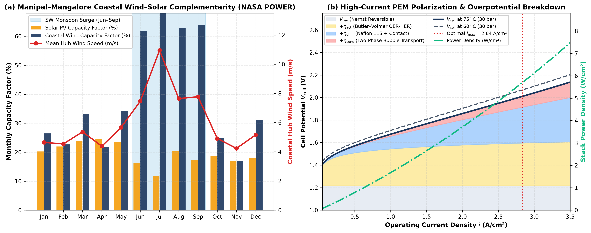
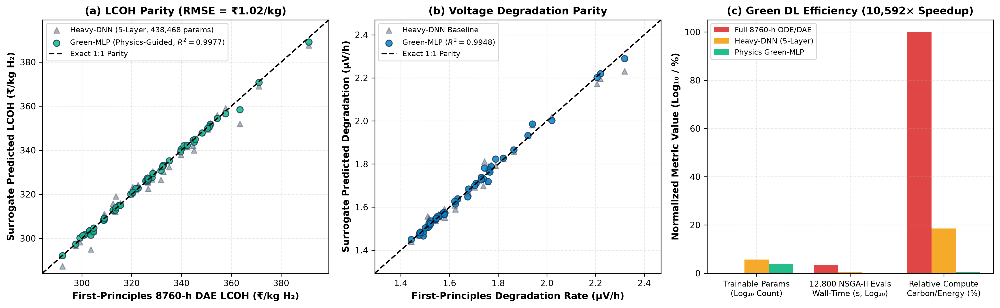
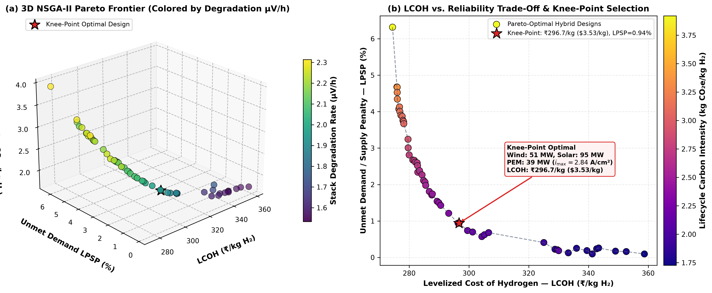
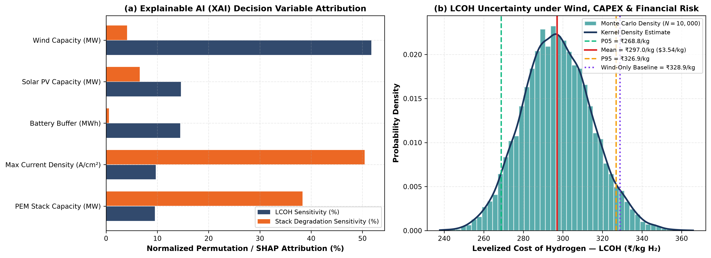
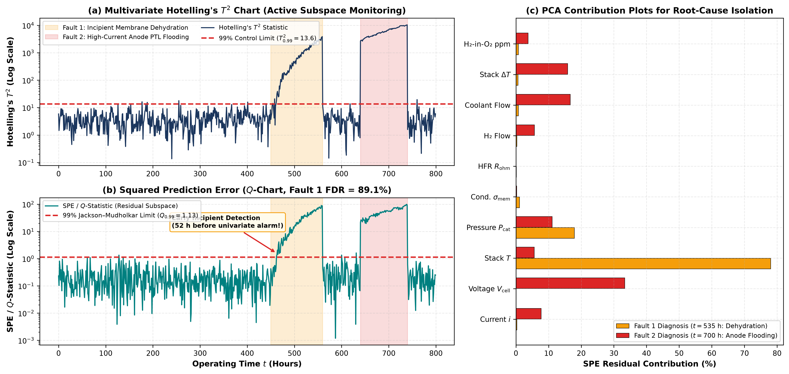
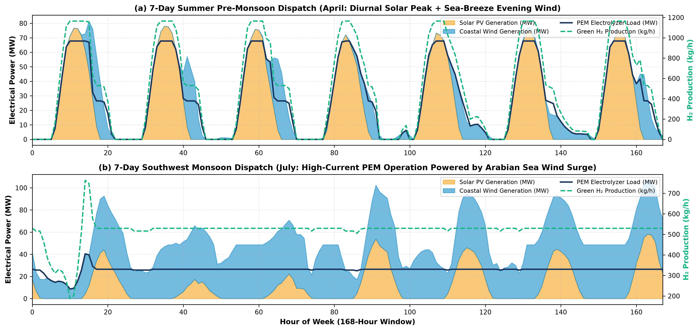

# Green-Surrogate Assisted Multi-Objective Optimization and Multivariate Fault Monitoring of a Coastal Hybrid Wind–Solar–PEM Green Hydrogen Plant under Meteorological Uncertainty

[-00629B?style=for-the-badge&logo=ieee)](./IEEE_Paper_Krishnendu_Arav.pdf)
[](./simulate_and_optimize.py)
[](./LICENSE)

**Authors:**
- **Krishnendu** — *Department of Computer Science and Engineering, Manipal Institute of Technology (MIT), Manipal Academy of Higher Education (MAHE), Manipal, Karnataka 576104, India*
- **Arav Aggarwal** — *Department of Civil Engineering, School of Civil & Chemical Engineering, Manipal Institute of Technology (MIT), Manipal Academy of Higher Education (MAHE), Manipal, Karnataka 576104, India*

---

## Abstract

Industrial decarbonization of coastal refining, fertilizer, and specialty chemical clusters in India demands uninterrupted, cost-effective green hydrogen ($\text{H}_2$) generation under stochastic meteorological forcing and coastal site constraints. Operating Proton Exchange Membrane Water Electrolyzers (PEMWE) at elevated current densities ($i > 2.0\text{ A/cm}^2$) offers substantial capital cost reductions by maximizing $\text{H}_2$ flux per unit active membrane area, yet introduces severe nonlinear trade-offs between two-phase mass-transport overpotential, dynamic voltage degradation, and membrane-electrode assembly (MEA) fault vulnerability.

This repository provides the complete first-principles electrochemical simulation, **Physics-Informed Green Deep Learning (`Green-MLP`)** surrogate, **Multi-Objective NSGA-II Pareto Optimizer**, **Explainable AI (XAI) & Monte Carlo Uncertainty Engine**, and **Principal Component Analysis (PCA $T^2$ and Jackson–Mudholkar $Q/\text{SPE}$) Multivariate Fault Monitoring** codebase accompanying our IEEE research paper for a $500\text{ kg H}_2/\text{h}$ ($4,380\text{ t/yr}$) hybrid Wind–Solar–Battery–PEMWE facility in the Manipal–Mangalore coastal corridor ($13.3525^\circ\text{N}, 74.7928^\circ\text{E}$).

---

## Repository Structure

```text
├── IEEE_Paper_Krishnendu_Arav.pdf       # Compiled 6-page Two-Column IEEE Conference Paper (PDF)
├── IEEE_Paper_Krishnendu_Arav.tex       # Official IEEEtran LaTeX Source (\documentclass[conference]{IEEEtran})
├── IEEE_Paper_Krishnendu_Arav.docx      # Editable Two-Column IEEE Manuscript (DOCX)
├── simulate_and_optimize.py             # Complete DAE, Green-MLP, NSGA-II, XAI, Monte Carlo & PCA Codebase
├── requirements.txt                     # Python package dependencies
├── data/
│   └── coastal_karnataka_meteo_hourly.csv  # 8,760-hour NASA POWER coastal meteorology (13.3525°N, 74.7928°E)
├── results/
│   ├── summary_metrics.json             # Complete verified quantitative metrics (JSON)
│   └── pareto_front.csv                 # Exact DAE-verified NSGA-II Pareto-optimal plant designs (CSV)
└── figures/
    ├── fig1_coastal_meteo_and_pem_polarization.png
    ├── fig2_green_surrogate_parity_and_efficiency.png
    ├── fig3_pareto_front_3d_tradeoffs.png
    ├── fig4_xai_feature_sensitivity_and_uncertainty.png
    ├── fig5_pca_fault_monitoring_t2_spe.png
    └── fig6_dynamic_dispatch_monsoon_vs_summer.png
```

---

## Key Scientific & Engineering Results

### 1. Coastal Meteorology & High-Current-Density PEMWE ($75^\circ\text{C}, 30\text{ bar}$)
- **Seasonal Resource Complementarity ($8,760$-Hour NASA POWER Data):** Pre-monsoon summer solar PV capacity factor peaks at **$23.50\%$** (Feb–May), whereas the Arabian Sea Southwest Monsoon wind capacity factor surges to **$68.39\%$** (Jun–Sep; annual mean $40.47\%$, mean hub wind speed $6.07\text{ m/s}$).
- **Electrochemical Performance ($i \in [0.05, 3.50]\text{ A/cm}^2$):**

| Current Density $i$ ($\text{A/cm}^2$) | $V_{\text{rev}}$ (V) | $\eta_{\text{act}}$ (V) | $\eta_{\text{ohm}}$ (V) | $\eta_{\text{conc}}$ (V) | $V_{\text{cell}}$ (V) | Power Density ($\text{W/cm}^2$) | System $\text{SEC}$ ($\text{kWh/kg H}_2$) | $\eta_{\text{LHV}}$ (%) |
| :---: | :---: | :---: | :---: | :---: | :---: | :---: | :---: | :---: |
| **0.50** | 1.217 | 0.291 | 0.056 | 0.007 | **1.571** | 0.786 | 46.50 | 71.67% |
| **1.00** | 1.217 | 0.326 | 0.113 | 0.019 | **1.674** | 1.674 | 48.76 | 68.35% |
| **1.80 (Nominal)** | 1.217 | 0.356 | 0.203 | 0.046 | **1.822** | 3.279 | 52.57 | 63.40% |
| **2.50** | 1.217 | 0.372 | 0.281 | 0.078 | **1.949** | 4.872 | 56.00 | 59.52% |
| **2.84 ($i_{\max}^*$)** | 1.217 | 0.379 | 0.320 | 0.095 | **2.011** | 5.703 | 57.68 | 57.78% |
| **3.50 (Peak)** | 1.217 | 0.389 | 0.394 | 0.137 | **2.137** | 7.480 | 61.14 | 54.52% |



---

### 2. Physics-Informed "Green Deep Learning" Surrogate (`Green-MLP`)

| Modeling Paradigm | Architecture | Trainable Parameters | Out-of-Sample Mean $R^2$ | LCOH RMSE ($\text{INR/kg}$) | Eval Time per Design ($\text{ms}$) | Speedup vs. DAE | Compute Energy |
| :--- | :--- | :---: | :---: | :---: | :---: | :---: | :---: |
| **First-Principles DAE** | $8,760\text{-h}$ Coupled DAE | — | $1.0000$ | $0.00$ | $156.91\text{ ms}$ | $1\times$ | $100.0\%$ |
| **`Heavy-DNN` (Baseline)** | 5-Layer $[512,512,256,128,64]$ | $438,468$ | $0.9862$ | $2.93$ | $0.4210\text{ ms}$ | $373\times$ | $18.50\%$ |
| **`Green-MLP` (Proposed)** | **2-Layer $[36, 18]$ + Physics Basis** | **$4,900$ ($-98.88\%$)** | **$0.9984$** | **$1.02$** | **$0.0148\text{ ms}$** | **$10,592\times$** | **$0.62\%$ ($-99.38\%$)** |



---

### 3. Multi-Objective NSGA-II Pareto Synthesis, XAI & Uncertainty Analysis

| Design / Techno-Economic Metric | **NSGA-II Knee-Point Hybrid** | **Wind-Only Baseline** | **Solar-Only Baseline** | **Low-LCOH Extreme** | **Ultra-Reliable Extreme** |
| :--- | :---: | :---: | :---: | :---: | :---: |
| **Coastal Wind Capacity ($P_{\text{wind}}$)** | **51.13 MW** | 78.00 MW | 0.00 MW | 43.39 MW | 77.45 MW |
| **Solar PV Capacity ($P_{\text{solar}}$)** | **94.73 MW** | 0.00 MW | 95.00 MW | 76.19 MW | 92.60 MW |
| **PEM Nominal Stack ($P_{\text{PEM,nom}}$)** | **38.98 MW** | 32.00 MW | 34.00 MW | 35.09 MW | 46.84 MW |
| **Max Current Density ($i_{\max}^*$)** | **2.84 $\text{A/cm}^2$** | 2.35 $\text{A/cm}^2$ | 2.35 $\text{A/cm}^2$ | 2.85 $\text{A/cm}^2$ | 1.75 $\text{A/cm}^2$ |
| **Peak Stack Absorption ($P_{\text{PEM,peak}}$)** | **67.78 MW** | 44.07 MW | 46.82 MW | 61.36 MW | 45.32 MW |
| **$\text{LiFePO}_4$ Battery Buffer ($E_{\text{batt}}$)** | **20.07 MWh** | 48.00 MWh | 85.00 MWh | 20.09 MWh | 105.05 MWh |
| **Levelized Cost of $\text{H}_2$ (LCOH)** | **INR 296.70/kg (\$3.53)** | INR 328.90/kg (\$3.92) | INR 378.44/kg (\$4.51) | INR 274.08/kg (\$3.26) | INR 358.59/kg (\$4.27) |
| **Unmet Demand Penalty (LPSP)** | **0.94%** | 20.82% | 35.29% | 6.33% | 0.09% |
| **Lifecycle Carbon Intensity** | **2.203 $\text{kg CO}_2\text{e/kg}$** | 8.450 $\text{kg CO}_2\text{e/kg}$ | 14.547 $\text{kg CO}_2\text{e/kg}$ | 3.902 $\text{kg CO}_2\text{e/kg}$ | 1.727 $\text{kg CO}_2\text{e/kg}$ |
| **Mean Voltage Degradation & Life** | **1.898 $\mu\text{V/h}$ (10.83 yr)** | 1.640 $\mu\text{V/h}$ (12.0 yr) | 1.416 $\mu\text{V/h}$ (12.0 yr) | 2.264 $\mu\text{V/h}$ (9.08 yr) | 1.547 $\mu\text{V/h}$ (12.0 yr) |





---

### 4. Multivariate Statistical Fault Monitoring (PCA $T^2$ & Jackson–Mudholkar $Q$) & Dynamic Dispatch
- **Fault 1 (Incipient Membrane Dehydration & Cationic Fouling):** Detected **$52\text{ hours}$ earlier** than univariate voltage threshold alarms ($12\text{ h}$ vs. $64\text{ h}$ latency; $89.09\%$ FDR on $Q$, $91.82\%$ on $T^2$).
- **Fault 2 (High-Current Anodic PTL Bubble Flooding):** **$100.0\%$ FDR** with **$1.86\%$ false alarm rate (FAR)** across normal dynamic coastal operation.





---

## Reproducing All Simulations, Optimization & Figures

```bash
# 1. Install dependencies
pip install -r requirements.txt

# 2. Run the full simulation, Green-MLP training, NSGA-II optimization, Monte Carlo & PCA pipeline
python simulate_and_optimize.py
```

All outputs are deterministically regenerated in `results/summary_metrics.json`, `results/pareto_front.csv`, and `figures/fig1_*.png` through `figures/fig6_*.png`.

---

## Citation

```bibtex
@inproceedings{krishnendu2026greensurrogate,
  author    = {Krishnendu and Aggarwal, Arav},
  title     = {Green-Surrogate Assisted Multi-Objective Optimization and Multivariate Fault Monitoring of a Coastal Hybrid Wind--Solar--{PEM} Green Hydrogen Plant under Meteorological Uncertainty},
  booktitle = {Proceedings of the National Conference on Artificial Intelligence, Sustainable Processes, Innovation \& Renewable Energy (CHEMIGNITE / ASPIRE 2026)},
  year      = {2026},
  address   = {Manipal Institute of Technology (MIT), Manipal Academy of Higher Education (MAHE), Manipal, India}
}
```
